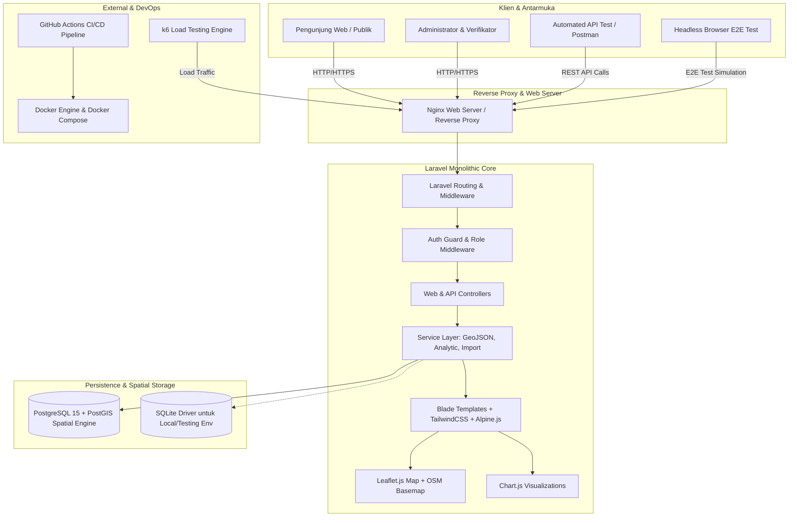

# Arsitektur Sistem: WebGIS Potensi Ekonomi UMKM Tembakau Kabupaten Pamekasan

## 1. Ringkasan Eksekutif
Aplikasi **WebGIS UMKM Tembakau Pamekasan** adalah Sistem Informasi Geospasial monolitik berbasis Laravel yang dirancang untuk pemetaan, pendataan, analisis potensi ekonomi, serta monitoring komoditas tembakau di 13 kecamatan Kabupaten Pamekasan, Madura, Jawa Timur.

Sistem dirancang memenuhi standar industri perkuliahan *Manajemen dan Proyek Sistem Informasi* dan *Software Quality Assurance (SQA)*, mencakup fungsionalitas spasial terpadu, keamanan berstandar OWASP, automasi pengujian (Unit, Feature, API, Playwright E2E, k6 Performance), CI/CD, hingga kesiapan deployment berbasis Docker container.

---

## 2. Diagram Arsitektur Tingkat Tinggi



---

## 3. Komponen Teknologi & Tanggung Jawab

| Layer | Komponen | Versi / Spesifikasi | Alasan Pemilihan & Tanggung Jawab |
|---|---|---|---|
| **Backend** | PHP & Laravel | PHP 8.2 / Laravel 11.x | Arsitektur monolitik tangguh, ORM Eloquent, route model binding, session auth, validasi kuat, ekosistem testing matang. |
| **Frontend Layout** | Blade + Tailwind CSS | Tailwind CSS v3 / Blade Components | Styling responsif, desain clean (Forest Green, Neutral Slate, White), bebas bloated JS bundle. |
| **Interaktivitas UI** | Alpine.js | Alpine.js v3 | Manajemen state reaktif ringan untuk modal, dropdown, drawer, dan filter tanpa framework berat. |
| **Spasial & Peta** | Leaflet.js | Leaflet v1.9+ | Peta interaktif, clustering marker UMKM, custom popup, layer kecamatan, GeoJSON parser. |
| **Visualisasi Data** | Chart.js | Chart.js v4 | Grafik distribusi produksi, komparasi per kecamatan, tren tenaga kerja berbasis data dinamis. |
| **Database** | PostgreSQL + PostGIS | PostgreSQL 15 + PostGIS 3.3 | Penyimpanan data relasional dan spasial koordinat serta poligon batas kecamatan. Didukung fallback SQLite/MySQL untuk testing lokal fleksibel. |
| **Pengujian** | PHPUnit / Pest | PHPUnit 10+ / Pest | Unit testing model/service, HTTP feature test, validasi, dan otorisasi. |
| **Automasi E2E** | Playwright | Node.js Playwright | Pengujian skenario alur pengguna nyata di browser (login, filter peta, CRUD, impor CSV). |
| **Load Testing** | k6 | Grafana k6 script | Uji beban konkurensi request peta, query agregasi dashboard, dan endpoint publik. |
| **Kontainerisasi** | Docker & Compose | Multi-stage Dockerfile | Portabilitas instalasi di server VPS manapun tanpa ketergantungan OS lokal. |

---

## 4. Struktur Folder Proyek

```text
MATKUL_TESTING_APK/
├── app/
│   ├── Http/
│   │   ├── Controllers/
│   │   │   ├── Admin/
│   │   │   │   ├── DashboardController.php
│   │   │   │   ├── UmkmController.php
│   │   │   │   ├── ImportController.php
│   │   │   │   ├── AnalysisController.php
│   │   │   │   └── ReportController.php
│   │   │   ├── Auth/
│   │   │   │   └── AuthController.php
│   │   │   └── Public/
│   │   │       ├── HomeController.php
│   │   │       ├── MapController.php
│   │   │       └── PublicReportController.php
│   │   ├── Middleware/
│   │   │   ├── EnsureRole.php
│   │   │   └── SecurityHeaders.php
│   │   └── Requests/
│   │       ├── StoreUmkmRequest.php
│   │       ├── UpdateUmkmRequest.php
│   │       └── CsvImportRequest.php
│   ├── Models/
│   │   ├── User.php
│   │   ├── District.php
│   │   ├── Category.php
│   │   ├── TobaccoUmkm.php
│   │   └── ImportLog.php
│   └── Services/
│       ├── EconomicAnalysisService.php
│       ├── GeoJsonService.php
│       └── CsvImportService.php
├── config/
├── database/
│   ├── data/
│   │   ├── pamekasan_districts.geojson
│   │   └── demo_umkm_tembakau_pamekasan.csv
│   ├── factories/
│   ├── migrations/
│   └── seeders/
│       ├── DatabaseSeeder.php
│       ├── DistrictSeeder.php
│       ├── CategorySeeder.php
│       ├── UserSeeder.php
│       └── DemoTobaccoUmkmSeeder.php
├── docs/
│   ├── ARCHITECTURE.md
│   ├── ERD.md
│   ├── FEATURE_LIST.md
│   ├── TEST_PLAN.md
│   ├── TEST_CASE_MATRIX.md
│   ├── DEFECT_LOG.md
│   ├── UAT_SCENARIOS.md
│   ├── CSV_SPECIFICATION.md
│   ├── MIGRATION_CUTOVER_PLAN.md
│   ├── ROLLBACK_PLAN.md
│   └── POST_IMPLEMENTATION_REVIEW.md
├── public/
│   ├── css/
│   ├── js/
│   └── images/
├── resources/
│   ├── css/
│   │   └── app.css
│   ├── js/
│   │   ├── app.js
│   │   ├── map.js
│   │   └── charts.js
│   └── views/
│       ├── layouts/
│       │   ├── app.blade.php
│       │   ├── admin.blade.php
│       │   └── navigation.blade.php
│       ├── public/
│       │   ├── home.blade.php
│       │   ├── map.blade.php
│       │   └── analysis.blade.php
│       └── admin/
│           ├── dashboard.blade.php
│           ├── umkm/
│           ├── import/
│           └── reports/
├── routes/
│   ├── web.php
│   └── api.php
├── tests/
│   ├── Feature/
│   │   ├── AuthTest.php
│   │   ├── UmkmCrudTest.php
│   │   ├── CsvImportTest.php
│   │   ├── MapFilterTest.php
│   │   └── EconomicAnalysisTest.php
│   ├── Unit/
│   │   ├── EconomicFormulaTest.php
│   │   └── CoordinateValidationTest.php
│   ├── postman/
│   │   └── WebGIS_Pamekasan.postman_collection.json
│   ├── playwright/
│   │   ├── auth.spec.js
│   │   ├── map_filter.spec.js
│   │   └── crud_umkm.spec.js
│   └── k6/
│       └── load_test.js
├── docker-compose.yml
├── Dockerfile
├── .env.example
└── README.md
```

---

## 5. Standar Keamanan & Perlindungan Data
1. **CSRF & Session Hijacking**: Laravel CSRF token pada setiap form POST/PUT/DELETE; Session cookie menggunakan atribut `HttpOnly`, `SameSite=Lax`, dan `Secure` pada mode produksi.
2. **SQL Injection**: Seluruh akses database menggunakan PDO parameterized query lewat Eloquent ORM.
3. **Cross-Site Scripting (XSS)**: Escaping otomatis sintaks Blade `{{ $variable }}` dan sanitasi input HTML.
4. **Otorisasi**: Multi-level Role Based Access Control (RBAC) pada middleware `EnsureRole:admin` membatasi modifikasi data hanya untuk pengelola resmi.
5. **Sanitasi File CSV**: Validasi MIME type (`text/csv`, `text/plain`), pembatasan ukuran file (maksimal 5MB), dan parsing per baris dengan transaksi atomik (`DB::transaction`).
