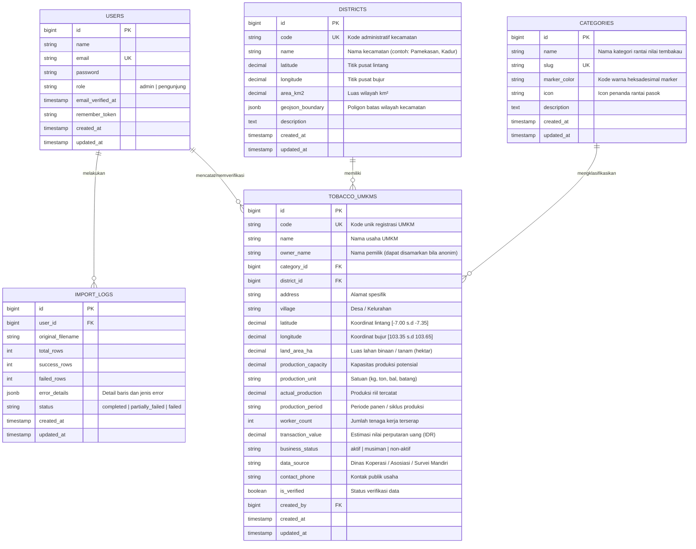

# Entity Relationship Diagram (ERD) & Skema Basis Data

## 1. Visualisasi Diagram Entitas (Mermaid ERD)

---

## 2. Rincian Kamus Data (Data Dictionary)

### A. Tabel `districts` (Kecamatan di Kabupaten Pamekasan)
Mencakup 13 kecamatan resmi:
1. Pamekasan (Kota)
2. Tlanakan
3. Pademawu
4. Galis
5. Larangan
6. Kadur
7. Pakong
8. Pegantenan
9. Palengaan
10. Proppo
11. Waru
12. Batumarmar
13. Pasean

- **id**: Primary Key (BIGSERIAL).
- **code**: Kode unik BPS/Kemendagri (VARCHAR 10, Unique).
- **name**: Nama kecamatan (VARCHAR 100).
- **latitude**: Koordinat centroid lintang (DECIMAL 10, 7).
- **longitude**: Koordinat centroid bujur (DECIMAL 10, 7).
- **area_km2**: Luas wilayah darat (DECIMAL 8, 2).
- **geojson_boundary**: Geometri poligon perbatasan kecamatan (JSONB / PostGIS GEOMETRY jika aktif).

### B. Tabel `categories` (Rantai Pasok Tembakau)
Klasifikasi rantai pasok industri tembakau:
1. `Petani & Pembibitan Tembakau` (Warna Marker: `#15803d` - Hijau Tua)
2. `Pengeringan & Pengolahan Daun` (Warna Marker: `#ca8a04` - Kuning Emas)
3. `Pengepul & Perdagangan Rajangan` (Warna Marker: `#ea580c` - Oranye Terakota)
4. `Produsen Sigaret Kretek Tangan (SKT)` (Warna Marker: `#dc2626` - Merah Tua)
5. `Industri Rokok Skala Kecil` (Warna Marker: `#7c3aed` - Ungu)
6. `Produk Olahan & Turunan Tembakau` (Warna Marker: `#0284c7` - Biru Laut)

### C. Tabel `tobacco_umkms` (Data Inti UMKM)
- Memiliki indeks komposit pada `(district_id, category_id)` untuk akselerasi query filter peta dan agregasi dashboard.
- Memiliki batasan spasial validasi: Latitude Pamekasan berada pada rentang `-7.3500000` hingga `-6.9500000`, dan Longitude berada pada rentang `103.3500000` hingga `103.6500000`.

---

## 3. Prinsip Normalisasi & Integritas Data
1. **Third Normal Form (3NF)**: Tidak ada redudansi transitif. Kategori dan Kecamatan dinormalisasi terpisah dengan Foreign Key berelasi `ON DELETE RESTRICT` untuk mencegah hilangnya data spasial secara tidak sengaja.
2. **PostGIS Compatibility**: Kolom `latitude` dan `longitude` bertipe `DECIMAL(10, 7)` yang secara alami portabel di SQLite/MySQL dan dapat dikonversi ke `ST_Point(longitude, latitude, 4326)` di PostgreSQL/PostGIS.
3. **Audit Trail**: Disertakan kolom `data_source`, `created_by`, dan timestamps untuk transparansi asal data perkuliahan.
