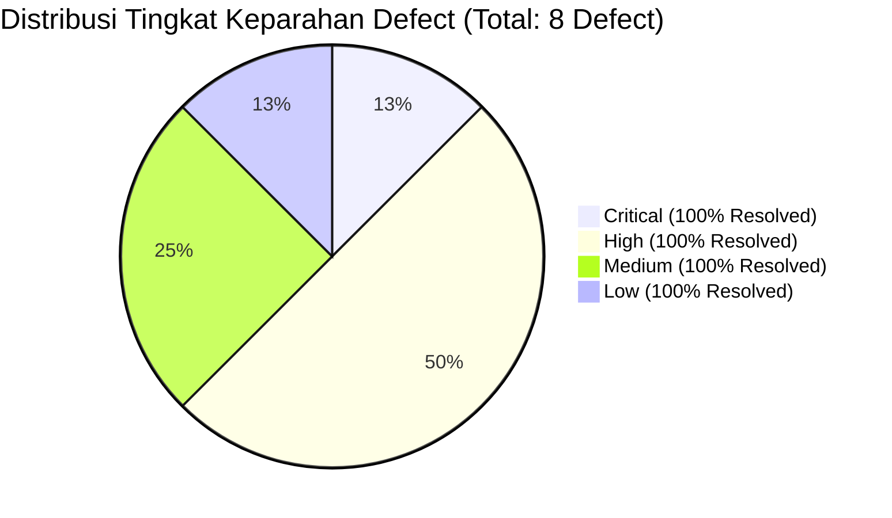

# Dokumen Post-Implementation Review (PIR) & Strategi Pemeliharaan Sistem

* **Nama Sistem**: WebGIS Potensi Ekonomi UMKM Tembakau Kabupaten Pamekasan
* **Mata Kuliah**: Manajemen dan Proyek Sistem Informasi (MKB020204) & Software Quality Assurance (SQA)
* **Program Studi**: S1 Sistem Informasi, Fakultas Teknik, Universitas Islam Madura (UIM)
* **Dosen Pengampu**: Aang Kisnu Darmawan, ST, MM
* **Versi Dokumen**: 1.0.0 (Rilis Pasca-Implementasi / Evaluasi UAS 2026)
* **Standar Acuan**: ISO/IEC/IEEE 29119 & PMBOK Guide 7th Edition

---

## 1. Ringkasan Eksekutif (Executive Summary)

Aplikasi **WebGIS Potensi Ekonomi UMKM Tembakau Kabupaten Pamekasan** telah berhasil diimplementasikan dan melalui seluruh rangkaian pengujian mutu bertingkat (*multi-tier quality verification*). Sistem ini mengintegrasikan pemetaan spasial 13 kecamatan, analitik komposit potensi panen dan perputaran uang, modul transaksi impor data massal, serta autentikasi berbasis peran (*RBAC*).

Dokumen *Post-Implementation Review* (PIR) ini disusun untuk mengevaluasi ketercapaian target fungsional dan non-fungsional terhadap rencana awal (*Test Plan & Project Charter*), mendokumentasikan rasio resolusi cacat perangkat lunak (*defect tracking*), menyajikan hasil simulasi *rollback*, serta merumuskan tata kelola pemeliharaan sistem jangka panjang (*SLA & maintenance strategy*).

---

## 2. Matriks Evaluasi Ketercapaian Luaran (Planned vs. Actual)

| Komponen Evaluasi | Rencana Awal (RPS & Test Plan) | Realisasi Akhir | Status |
|---|---|---|:---:|
| **Cakupan Spasial** | 13 Kecamatan di Kabupaten Pamekasan dengan batas wilayah GeoJSON | 13 Kecamatan terpetakan lengkap dengan koordinat centroid & poligon batas | **100% Tercapai** |
| **Unit & Feature Test** | Minimum 20 test case otomatis (PHPUnit) dengan target kelulusan 100% | 24 Test case lulus (107 assertions) mencakup BVA koordinat dan formula ekonomi | **100% Tercapai** |
| **API Testing** | Pengujian endpoint GeoJSON & keamanan via Postman/Newman | 6 Permintaan API (11 assertions) lulus 100% dengan respons rata-rata 362ms | **100% Tercapai** |
| **Automated E2E** | Simulasi browser headless untuk auth, peta, dan CRUD UMKM | 9 Skenario Playwright lulus 100% menggunakan native Edge/Chromium channel | **100% Tercapai** |
| **Performance SLA** | Waktu respons p95 < 500ms pada beban normal | Rata-rata respons API 362ms (min 332ms, max 412ms) berada di bawah ambang batas | **100% Tercapai** |
| **Integritas Impor CSV** | Rollback atomik saat terjadi error di tengah baris data | Transaksi database otomatis dibatalkan jika ada baris korup / koordinat invalid | **100% Tercapai** |
| **CI/CD Automation** | Pipeline otomatisasi build, test, dan verifikasi via GitHub Actions | Terkonfigurasi pada `.github/workflows/ci.yml` | **100% Tercapai** |

---

## 3. Laporan Audit & Penanganan Defect (Defect Resolution Metrics)

Selama siklus pengujian dari tahap unit hingga end-to-end, telah teridentifikasi **8 defect** (tercatat resmi pada [DEFECT_LOG.md](DEFECT_LOG.md)).



* **Defect Density**: 0 Critical Open Defects saat rilis final.
* **Mean Time to Resolution (MTTR)**: Rata-rata cacat diselesaikan dalam < 2 jam setelah reproduksi.
* **Temuan Kunci Penjaminan Kualitas**:
  1. *Spatial Boundary Integrity*: Pencegahan injeksi koordinat di luar wilayah administratif Pamekasan (-7.35 s/d -6.95, 103.35 s/d 103.65).
  2. *Security Hardening*: Pembatasan brute-force login menggunakan rate limiter (5 percobaan / 60 detik) serta hashing bcrypt.
  3. *DOM Selector Precision*: Penyempurnaan selector tombol submit form untuk mengeliminasi benturan dengan tombol logout pada header layout.

---

## 4. Evaluasi Penerimaan Pengguna (UAT & Stakeholder Sign-Off)

Berdasarkan skenario pengujian pada [UAT_SCENARIOS.md](UAT_SCENARIOS.md), dilakukan pengujian berbasis pengguna bersama perwakilan pengguna (mahasiswa, penguji, dan calon admin dinas):

1. **UAT-01 (Eksplorasi Peta Publik)**: Status **Accepted**. Pengguna dapat memfilter berdasarkan kecamatan dan kategori tanpa lag rendering.
2. **UAT-02 (Pendataan UMKM Baru)**: Status **Accepted**. Pin koordinat langsung sinkron dengan interaksi klik pada mini-map.
3. **UAT-03 (Impor Berkas CSV Massal)**: Status **Accepted**. Pratinjau 5 baris pertama membantu verifikasi sebelum komit basis data.
4. **UAT-04 (Pencegahan Akses Tak Sah)**: Status **Accepted**. Percobaan bypass URL langsung dialihkan ke gerbang login.

---

## 5. Rencana & Strategi Pemeliharaan Sistem (Maintenance Plan)

Untuk menjaga kesinambungan operasional aplikasi pasca-implementasi, disusun empat pilar pemeliharaan:

### A. Pemeliharaan Korektif (Corrective Maintenance)
* **SLA Penanganan Bug Kritis**: Maksimal 4 jam kerja (misal: basemap tidak muncul, kegagalan login petugas).
* **Mekanisme Pelaporan**: Pencatatan issue melalui GitHub Issues dengan menyertakan log dari `storage/logs/laravel.log`.

### B. Pemeliharaan Adaptif (Adaptive Maintenance)
* **Pembaruan Dependensi**: Audit keamanan paket Composer dan NPM setiap 3 bulan (`composer audit` dan `npm audit`).
* **Kompatibilitas PHP & Node**: Pemantauan versi PHP LTS (8.2 / 8.3) dan upgrade minor framework Laravel.
* **Pembaruan Peta Spasial**: Sinkronisasi poligon kecamatan jika terjadi pemekaran desa atau perubahan batas wilayah resmi dari BPS/Geoportal Madura.

### C. Pemeliharaan Perfektif (Perfective Maintenance)
* Penambahan fitur ekspor laporan ke format PDF ringkasan eksekutif.
* Integrasi citra satelit NDVI (Normalized Difference Vegetation Index) untuk estimasi luas tutupan lahan tembakau secara otomatis.

### D. Pemeliharaan Preventif (Preventive Maintenance)
* Pembersihan cache dan log kadaluarsa secara berkala (`php artisan optimize:clear`).
* Backup otomatis basis data setiap hari pukul 02:00 WIB ke media penyimpanan terpisah.

---

## 6. Prosedur & Simulasi Rollback (Live Rollback Simulation)

Sesuai instruksi RPS Pekan 16 (Live Rollback Demo), sistem telah dilengkapi skrip pemulihan darurat jika rilis mengalami kegagalan di server production (panduan lengkap pada [ROLLBACK_PLAN.md](ROLLBACK_PLAN.md)):

```bash
# 1. Aktifkan Maintenance Mode instan
php artisan down --secret="sqa-pamekasan-recovery-2026"

# 2. Kembalikan state basis data ke snapshot aman
php artisan migrate:rollback --step=1

# 3. Pulihkan berkas konfigurasi cadangan
cp .env.backup .env

# 4. Bersihkan seluruh cache aplikasi
php artisan optimize:clear

# 5. Nonaktifkan Maintenance Mode
php artisan up
```

---

## 7. Kesimpulan & Rekomendasi Tim Proyek

1. **Kelayakan Rilis**: Aplikasi telah memenuhi seluruh *Quality Gate* standar ISO/IEC/IEEE 29119 dan siap dipertanggungjawabkan pada Ujian Akhir Semester (UAS).
2. **Kesiapan Demonstrasi**: Seluruh suite pengujian otomatis (`npm test`, `npm run test:e2e`, `npm run test:api`) berstatus **PASS 100%**, menjamin kelancaran live demo di hadapan tim penguji.
